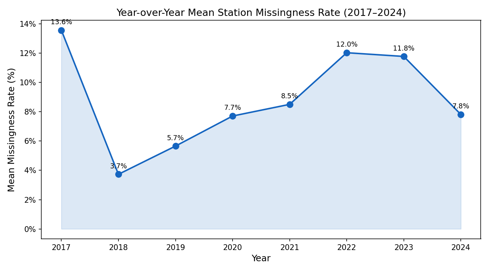
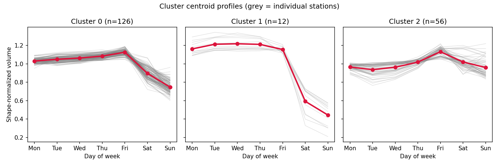
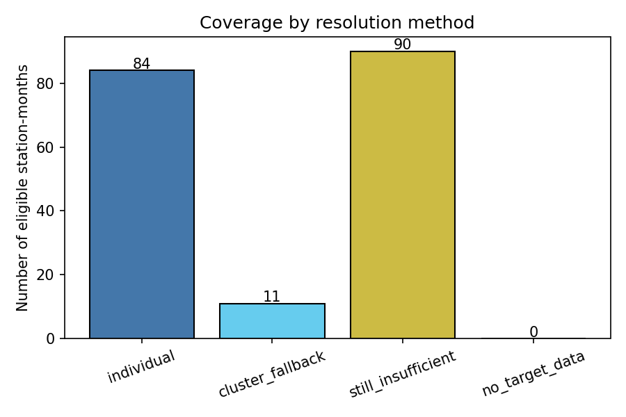

# Contributions to the GDoT Data-Sufficiency Project — Kevin Li

This repository collects **my own work** on the Georgia DOT continuous count station (CCS)
data-sufficiency project (April–August 2026). The project asks how many observed days of a partially
missing month are enough to trust a station's monthly average daily traffic. The main paper answers
this with a conformal-prediction procedure.

> **Start here → [`CONTRIBUTIONS.pdf`](CONTRIBUTIONS.pdf)**, a 2-page summary of what I did and what I
> found. The [Where to look](#where-to-look) table below maps each claim to its source.

**Not in this repo:** the main paper, its pipeline (`code/`), its figures, and the project's progress
slides. Those belong to the paper's authors. Everything here is work I did alongside the paper. My code
reads the paper's code and data **read-only** and never modifies them.

## Two workstreams

| | What | Headline result |
|---|---|---|
| **1. [Exploratory data analysis](eda/)** | A full EDA of the 286-station network, 2017–2024, run as an 8-agent AI pipeline that I designed and specified | 21,837 station-months audited (91.6% complete). Every station given an outage style. 243 stations (84.9%) rated HIGH-trust. 27 reference-station candidates identified. |
| **2. [Cluster-pooled fallback](cluster_fallback/)** | Found that the paper's pool-size rule silently drops **101 of 185** eligible stations (55%). As a self-directed learning exercise, built and validated a fix that pools stations with similar weekly traffic shapes. Not proposed as a change to the paper. | Coverage rose from 84 to 95 stations, but accuracy **lost to a simpler same-functional-class baseline**, so the fix was **not adopted**. Separately, shape-normalization proved load-bearing (ARI = 0.028 vs raw-volume clustering). |

Five follow-up ideas on the missingness problem are written up in
[`research_directions.md`](research_directions.md).

## Selected figures

**EDA:** missingness is operationally driven, not random. It peaks in 2017 and again in 2022–23, when
the data pipeline changed over. Research direction 5 asks whether this spike threatens the paper's
exchangeability assumption.



**Cluster fallback:** the three weekly-shape clusters (K = 3, silhouette 0.406). Cluster 1 is an
extreme weekday-only, freight-like pattern.



**Cluster fallback:** coverage after the fallback. It rescues 11 stations, but most of the dropped
network stays unresolved.



| k\* error vs ground truth (20 holdout stations × 6 mechanisms) | n | MAE (days) | RMSE | Bias | Corr. |
|---|---|---|---|---|---|
| Cluster fallback (this work) | 100 | 3.48 | 4.85 | +0.68 | 0.735 |
| Baseline: same functional class | 96 | **2.91** | **4.30** | −1.26 | **0.818** |
| Baseline: pool all stations | 108 | 3.18 | 4.89 | +2.10 | 0.787 |

## Where to look

| Path | Contents |
|---|---|
| [`CONTRIBUTIONS.pdf`](CONTRIBUTIONS.pdf) | 2-page contribution summary ([`.tex` source](CONTRIBUTIONS.tex), built with XeLaTeX) |
| [`deliverables/eda_final_slides.pdf`](deliverables/eda_final_slides.pdf) | Final EDA presentation, 14 slides |
| [`deliverables/eda_final_report.pdf`](deliverables/eda_final_report.pdf) | Final EDA report (14 pp) |
| [`deliverables/ai_pipeline_design.pdf`](deliverables/ai_pipeline_design.pdf) | Design of the 8-agent EDA pipeline |
| [`eda/claude.md`](eda/claude.md) | The 475-line multi-agent specification I wrote |
| [`eda/eda_output/reports/master_eda_summary.md`](eda/eda_output/reports/master_eda_summary.md) | Synthesized EDA findings across all agents |
| [`eda/`](eda/) | All EDA code, agent reports and figures (36), one folder per agent |
| [`cluster_fallback/REPORT.md`](cluster_fallback/REPORT.md) | Full interpretation of the fallback experiment, figure by figure |
| [`cluster_fallback/`](cluster_fallback/) | The fallback code (6-module library plus 4 pipeline scripts) and all outputs |
| [`research_directions.md`](research_directions.md) | Five documented next-step ideas |

## How AI was used

Both workstreams were carried out by AI coding agents working from specifications I wrote. The agents
wrote the code and ran the analysis. I framed the problems, designed the pipeline and the experiments,
wrote the specifications ([`eda/claude.md`](eda/claude.md) is one), and evaluated the results. The
specification requires every agent to report its own risks and caveats and forbids overclaiming. That
is why the outputs flag their own failures, such as a broken holiday-effect join and an archetype
clustering that did not separate, rather than hiding them.

## Running the code

- **`cluster_fallback/`** reuses the paper's pipeline and shipped data. Set `GDOT_PROJECT_ROOT` to a
  checkout of the project repository (the directory containing `code/`), then follow
  [`cluster_fallback/README.md`](cluster_fallback/README.md). Re-running `run_cluster_fit.py` reproduces
  the original run's cluster labels byte-for-byte.
- **`eda/`** agent scripts ran against the raw GDoT CCS archives (about 33 GB). Those archives are not
  distributed here, so the scripts document the method rather than being runnable from this repo. Their
  reports and figures are committed.

```bash
pip install -r requirements.txt
```

## Data note

This repository contains **no data**. Every table the pipelines produce is derived from Georgia DOT CCS
records, so those tables are not published here; the scripts regenerate them. The reports, figures and
slides are included. Reports may refer to tables (`*.csv`, `*.parquet`) by name, but those files stay
local.
